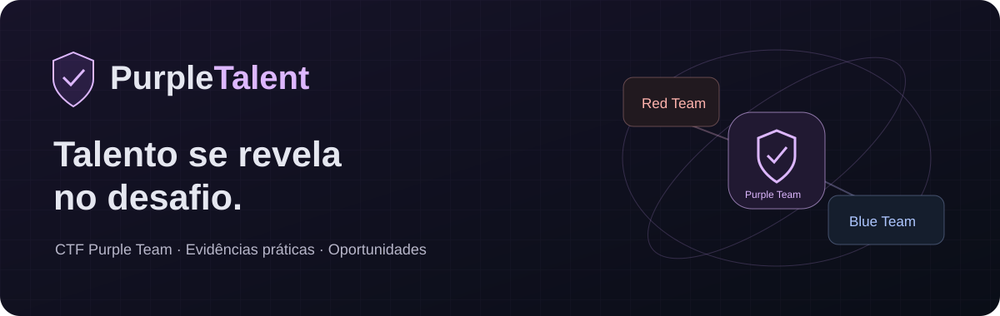

# Purple Talent — Recrutamento por evidências em cibersegurança

<p align="center">
  
</p>

<p align="center">
  
  
  
  
  
  
  
  
</p>

<p align="center"><strong>O conhecimento aparece no currículo. A competência se revela na prática.</strong></p>

---

## O que é o Purple Talent?

O **Purple Talent** conecta desafios práticos de cibersegurança ao processo de descoberta de talentos. Participantes investigam falhas, analisam evidências e documentam soluções; recrutadores podem examinar os resultados e compreender o raciocínio por trás de cada resolução.

O projeto nasce no **Desafio de Ideias do SENAI**, no contexto do projeto SAGA e da proposta de CTF **Purple Team**, com a **LabWare como empresa destinatária da proposta**. O objetivo é aproximar formação prática e recrutamento, com atenção à segurança de aplicações e aos contextos de sistemas laboratoriais.

A intenção de uso pela empresa orienta o desenvolvimento. Dados demonstrativos e vagas fictícias não representam processos seletivos reais, parceria comercial formalizada ou homologação em produção.

## O que ele entrega?

### Para quem participa

- Desafios de ataque, defesa e convergência Purple Team.
- Envio de bandeiras e relatórios de resolução.
- Pontuação vinculada a resultados aceitos pelo servidor.
- Dossiê que reúne perfil e evidências técnicas.

### Para quem recruta

- Talent Pool e ranking por trilha e pontuação.
- Consulta de competências informadas e resoluções registradas.
- Vagas relacionadas às trilhas de cibersegurança.
- Uma base para avaliar evidências, complementada pela análise humana.

### Para quem organiza

- Ambiente local reproduzível com Docker Compose.
- Banco PostgreSQL e migrações versionadas.
- Laboratório educativo separado da plataforma.
- Testes de API, regras de acesso e documentação operacional.

> **Evolução em andamento:** cadastro, perfil com consentimento, avaliação por rubrica, relatório para impressão, compatibilidade de vagas e acompanhamento de candidaturas. A implementação e a verificação de cada fluxo são registradas nos documentos abaixo; esta seção será atualizada a cada marco concluído.

## Como funciona?

```text
Participante → desafio autorizado → investigação e resolução
                                        ↓
                           flag + relatório + evidências
                                        ↓
                         pontuação e avaliação humana
                                        ↓
                        dossiê → oportunidades → seleção
```

Red Team explora os problemas do cenário autorizado. Blue Team investiga e propõe medidas de defesa. Purple Team conecta as descobertas à melhoria da proteção. O ranking apoia a análise: não decide contratações e não substitui a avaliação do contexto.

## Arquitetura

```text
Navegador
   │ mesma origem
   ▼
Gateway Nginx :8088
   ├── /       → PHP + HTML + JavaScript + Tailwind
   └── /api/   → Fastify → Prisma → PostgreSQL

Laboratório CTF :8091
   └── rede independente, acesso local e dados fictícios
```

O PHP monta páginas e componentes. A API centraliza identidade, permissões e regras de negócio. Os serviços de laboratório não têm acesso direto ao banco ou à API e não recebem o socket do Docker.

## Proteções implementadas na fundação

| Área | Controle |
| --- | --- |
| Autenticação | Senhas com scrypt e sessões persistidas por hash |
| Navegador | Cookie HttpOnly, SameSite e validação de origem nas mutações |
| Acesso | Papéis verificados na API e restrição do dossiê individual |
| Validação | Schemas de entrada, limites de tamanho e tentativas |
| Pontuação | Validação no servidor e unicidade por participante/desafio |
| Banco | Relações e restrições versionadas em migrações |
| Laboratório | Rede separada, recursos limitados e porta em loopback |
| Interface | Conteúdo do usuário renderizado como texto e CSP |

Esses controles são verificáveis no código e nos testes. Não constituem certificação de segurança ou conformidade legal. A operação pública requer revisão própria de infraestrutura, privacidade, capacidade, backup e monitoramento.

## Stack tecnológica

| Camada | Tecnologia |
| --- | --- |
| Páginas e componentes | PHP + HTML |
| Interações e API client | JavaScript com módulos ES |
| Estilos | CSS + Tailwind CSS compilado |
| API | Node.js + Fastify |
| Persistência | Prisma + PostgreSQL |
| Ambiente | Docker Compose + Nginx |
| Testes | Node.js test runner, Fastify inject e navegador Playwright |
| Tipografia | Plus Jakarta Sans, Inter e JetBrains Mono locais |

## Documentação

- [Planejamento e etapas](PLANEJAMENTO.md): escopo, personas, arquitetura, critérios de aceite, riscos e gestão dos agentes.
- [Execução Docker e laboratório](infra/README.md): configuração, inicialização e diagnóstico.
- [Contrato e operação da API](api/README.md).
- [Evidências de verificação](docs/VERIFICACAO.md).

Os arquivos em `stitch_purple_ctf_talent_platform/` são referências preservadas. A interface utiliza Plus Jakarta Sans, Inter e JetBrains Mono, com fontes locais e CSS compilado. A empresa, as oportunidades e os candidatos da demonstração não representam parceria comercial ou processo seletivo real.

## Como rodar

Requer Docker Desktop com engine Linux ativo e Compose. Em uma instalação nova, copie `.env.example` para `.env` e preencha os valores locais conforme `infra/README.md`. Se `.env` já existe, preserve-o: mudar a senha na configuração não muda automaticamente a senha do volume PostgreSQL.

```powershell
docker compose config --quiet
docker compose up --build -d
docker compose run --rm api npm run db:seed
docker compose ps
```

Abra [a plataforma local](http://localhost:8088). Contas fictícias: `recrutador@purpletalent.local` e `candidato@purpletalent.local`; a senha é o valor de `DEMO_PASSWORD` no seu ambiente local. Não há senha pública fixa no código.

Para incluir o exercício opcional:

```powershell
docker compose --profile labs up --build -d lab
```

O laboratório fica em [localhost:8091](http://localhost:8091). O desafio `web-investigation` usa a mesma `LAB_FLAG` configurada antes do primeiro seed. Reiniciar o laboratório não apaga o banco. Não exponha este ambiente vulnerável à internet.

## Estrutura e responsabilidades

| Pasta | Conteúdo |
| --- | --- |
| `web/` | Páginas PHP, componentes, interação JS, estilos e fontes |
| `api/` | API Fastify, autenticação, regras, Prisma, migração e seed |
| `infra/` | Gateway Nginx e operação local |
| `labs/` | Laboratório independente e testes |
| `docs/` | Evidências e pendências da entrega |

O PHP compõe a interface. A API é a única camada que autentica usuários, aplica permissões e acessa o banco. O gateway publica páginas e `/api/` na mesma origem. O laboratório não compartilha a rede do banco ou da API.

## Verificar componentes

```powershell
Push-Location api
npm ci
npm run db:generate
npm test
Pop-Location
Push-Location web
npm ci
npm run build
Pop-Location
node --test labs/access-review/server.test.mjs
docker compose config --quiet
```

Os testes da API com repositório em memória não comprovam migrações ou concorrência no PostgreSQL. Consulte as evidências para distinguir verificações executadas de integrações ainda pendentes.

## Estado e próximos passos

A fundação inclui páginas de painel, ranking, arenas, dossiê, vagas e login, contrato de API, pontuação por submissão aceita e exercício educativo. O avanço depende dos critérios em `PLANEJAMENTO.md`: evento/equipes, revisão humana de evidências, relatório, proteção de dados, piloto e posterior produção.

Não há contratação automática, antifraude garantido, correção automática de defesa ou terminal remoto. O acompanhamento das etapas está no [aceite da versão](docs/ACEITE-V1.md). Uso com dados reais e publicação em produção exigem validação operacional própria.

Este subprojeto tem repositório próprio: [Breno-J-Oliveira/purple-talent](https://github.com/Breno-J-Oliveira/purple-talent). O versionamento é independente do portfólio pai; seu `.gitignore` não foi alterado. Arquivos `.env`, dependências e artefatos temporários ficam fora do Git.

## Desenvolvimento e revisão humana

Cada marco registra o comportamento entregue, os testes executados e as limitações conhecidas. A versão final de revisão deve cumprir os critérios em [ACEITE-V1](docs/ACEITE-V1.md). A aprovação de conteúdo, identidade e aderência ao contexto do SENAI e da empresa será feita pelo responsável pelo projeto.

O formato desta documentação foi inspirado no [README do NexusAuth](https://github.com/Breno-J-Oliveira/NexusAuth), adaptando a apresentação à arquitetura e às evidências do Purple Talent.

## Autor e contato

Desenvolvido por **Breno J. Oliveira**, no contexto do Desafio de Ideias do SENAI.

<p align="center">
  <a href="https://github.com/Breno-J-Oliveira"></a>
  <a href="https://www.linkedin.com/in/breno-j-oliveira-672619352/"></a>
</p>
